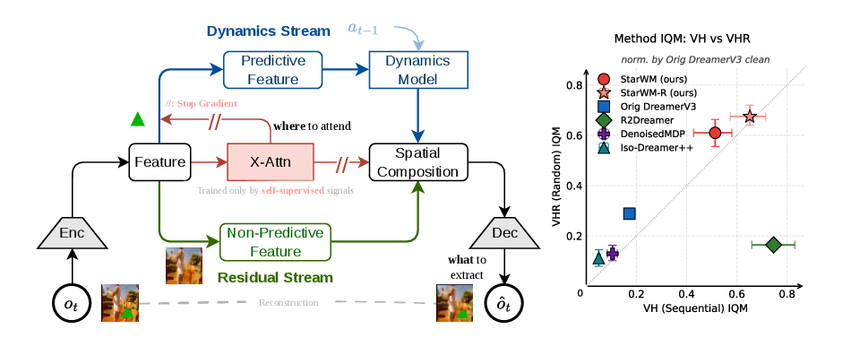

# StarWM: Self-Supervised Trained Attention Routing for Robust World Models

Official code for **StarWM** (Zeqiang Zhang, Fabian Wurzberger, Maximilian Otte, Daniel Schmid,
Sebastian Gottwald, Arne Peter Raulf, Daniel Alexander Braun).



StarWM changes only the encoder and decoder of DreamerV3.

- **Cross-attention routing.** N learnable queries attend over the encoder's 8×8 feature map.
  The attended *entity tokens* are the only input to the RSSM.
- **Self-supervised location / content separation.** The attention parameters are trained only
  by inverse dynamics and a temporal contrastive loss (plus reward prediction in **StarWM-R**).
  Stop-gradient barriers keep RSSM and reconstruction gradients away from them.
- **Dual-stream decoder.** The dynamics stream is painted back onto the attended locations;
  a Gaussian-bottleneck residual stream (discarded during imagination) explains the rest of the image.

The diagnostic environments (Shape / NoisyShape and variants) are a separate package:
**[ShapeEnv](https://github.com/zeqiang-zhang/ShapeEnv)** (Python package `shapeenv`).

## Installation

```bash
conda create -n starwm python=3.12 -y && conda activate starwm
pip install -r requirements.txt   # versions used for the paper; also installs ShapeEnv from GitHub
```

The paper's runs used Python 3.12.12, PyTorch 2.10 (CUDA 12.6), MuJoCo 3.5.0 and dm_control 1.0.37
on single NVIDIA A100/H100 GPUs. Rendering uses EGL (`MUJOCO_GL=egl`, set by `train.py`).

**Data.**

| needed for | dataset | how |
|---|---|---|
| DMC Video-Hard (VH) / Video-Hard-Random (VHR) | DMC-GB2 `video_hard` videos (100 clips, RealEstate10K-based) | clone [DMC-GB2](https://github.com/aalmuzairee/dmcgb2) and `export DMCGB_DATA_DIR=<dmcgb2>/envs/dmcgb/data` (or copy `video_hard/` into `envs/dmcgb/data/`) |
| NoisyShape family, DMC Reacher | DAVIS 2017 train+val 480p | `wget https://data.vision.ee.ethz.ch/csergi/share/davis/DAVIS-2017-trainval-480p.zip`, unzip, `export DAVIS_DIR=<...>/DAVIS/JPEGImages/480p` |
| CALVIN (Appendix F.3) | CALVIN `task_D_D` | see [`calvin/README.md`](calvin/README.md) |

## Quick start

```bash
# StarWM on NoisyShape (reward-free, world model only; ~212k env steps)
python train.py --configs noisyshape --logdir runs/noisyshape/starwm_s0 --seed 0

# StarWM on DMC Walker Walk with random-frame video distractors (VHR, 1M steps)
python train.py --configs dmc_vision --task dmc_walker_walk --use_video_hard True \
    --video_random_frames True --steps 1e6 --logdir runs/dmc/vhr/walker_walk/starwm_s0 --seed 0

# StarWM-R (reward prediction as an additional routing signal) and the DreamerV3 baseline
python train.py --configs dmc_vision --task dmc_walker_walk --use_video_hard True --steps 3e6 \
    --attn_reward_scale 30 --logdir runs/dmc/vh/walker_walk/starwm_r_s0
python train.py --configs dmc_vision dreamerv3 --task dmc_walker_walk --use_video_hard True \
    --steps 3e6 --logdir runs/dmc/vh/walker_walk/dreamerv3_s0
```

Re-running a command with the same `--logdir` resumes from `latest.pt` and the stored replay.
Logs are written as `metrics.jsonl` and TensorBoard events; the full config is saved to
`<logdir>/config.yaml`.

## Reproducing the paper

Every training run behind a figure or table is listed in `scripts/experiments.py`
(136 experiments × 3 seeds).

```bash
python scripts/experiments.py list 'dmc/vhr/*'                 # names + paper reference
python scripts/experiments.py show dmc/vh/cheetah_run/starwm_r # exact command
python scripts/experiments.py run 'noisyshape/*' --parallel    # seeds 0,1,2 in parallel, logs in runs/
```

Running the three seeds of one experiment concurrently on one GPU (`--parallel`) is how the paper's
runs were executed. Approximate cost per task and method (3 seeds on one GPU) is about 35 GPU-hours
for Clean or VHR (1M steps) and 94 GPU-hours for VH (3M steps); see Table 2.

| Paper | Experiments (`scripts/experiments.py`) | Analysis |
|---|---|---|
| Fig. 1 (right), Fig. 5, Table 5, Fig. 10 | `dmc/{clean,vh,vhr}/<task>/{starwm,starwm_r,dreamerv3}` + baselines | [`analysis/dmc`](analysis/dmc/README.md) |
| Fig. 3, Table 4 | `noisyshape/{starwm,dreamerv3,dualstream,ss_only,dualstream_ss,attention_only}` + R2-Dreamer, Iso-Dream++ | [`analysis/noisyshape`](analysis/noisyshape/README.md) |
| Fig. 4 | `noisyshape/starwm` | `analysis/noisyshape/viz_composition_swap.py` |
| Fig. 6, Fig. 11 | `dmc/*/cheetah_run/starwm`, `dmc/vh/cartpole_swingup/{starwm,starwm_r}` | `analysis/dmc/viz_attention.py` |
| Figs. 7, 13, 14, Tables 7, 8 | `dmc/{clean,vhr}/{walker_walk,cheetah_run}/{starwm,iso_star1,iso_star3}` | `analysis/dmc` |
| Fig. 12 | `noisyshape/{starwm,iso_star1..4}` | `analysis/noisyshape/plot_detach_ablation.py` |
| Table 9 | `sensitivity/*` | `analysis/dmc/stress_tables.py` |
| Fig. 15 | `noisyshape/{starwm,inv_only,ctr_only}` | `analysis/noisyshape/plot_ss_ablation.py` |
| Fig. 16 | `dmc/*/{cartpole_swingup,cheetah_run,walker_run}/{starwm,inv_only}` | `analysis/dmc/plot_contrastive.py` |
| Fig. 17, Table 10 | `dmc/vh/<task>/N{1,2,8}` (+ `starwm` for N=4) | `analysis/dmc/plot_queries.py` |
| Fig. 18, Table 11 | `noisyshapemotion/*` | `analysis/noisyshape/plot_motion.py` |
| Fig. 19, Table 12 | `{shape,shapefixed,noisyshape,noisyshapeseq}/*` | `analysis/noisyshape/plot_progressive.py` |
| Fig. 20 | `dmc_small/*` + R2-Dreamer | `analysis/dmc/plot_small_objects.py` |
| Figs. 21, 22 | `noisytwoshape/*` | `analysis/noisyshape/plot_two_shape.py`, `viz_two_shape_attention.py` |
| Figs. 23, 24, Table 13 | `texnoisyshape/L{1,2,3}/*` | [`analysis/textured`](analysis/textured/README.md) |
| Table 14, Fig. 25 | `dmc_lowcontrast/*` + R2-Dreamer | `analysis/dmc/plot_lowcontrast.py`, `stress_tables.py` |
| Table 15, Fig. 26 | CALVIN | [`calvin`](calvin/README.md) |
| Figs. 27, 28, Table 16 | `passiveshape/starwm`, `passiveshapeseq/starwm` | [`analysis/passive`](analysis/passive/README.md) |
| Table 17, Fig. 29 | `dmc_reacher/*` + R2-Dreamer | `analysis/dmc/plot_reacher.py`, `stress_tables.py` |
| Table 19 | `delay/*` | [`analysis/delay`](analysis/delay/README.md) |

Baselines (R2-Dreamer, DenoisedMDP, Iso-Dream++) are their official implementations, patched only
to use the same environments. See [`baselines/README.md`](baselines/README.md).

## Code overview

```
train.py              training loop (from dreamerv3-torch); --model starwm | dreamerv3 | dualstream | attention_only
configs.yaml          defaults (= paper hyper-parameters, Table 1) and presets
starwm.py             StarWM world model: cross-attention routing, SS losses, dual-stream decoder
models.py             DreamerV3 world model and the actor-critic shared by all models
ablations/            '+ dual-stream' and '+ attention only' ablation world models (Table 4)
networks.py, tools.py, exploration.py, parallel.py    unchanged DreamerV3 components
envs/                 DMC wrapper, Video-Hard wrapper (DMC-GB2), small-object variant, wrappers
scripts/experiments.py  registry of all paper runs
analysis/             probes, figures and tables (one README per sub-folder)
calvin/               offline CALVIN experiment
baselines/            patches + launch scripts for R2-Dreamer, DenoisedMDP, Iso-Dream++
```

Key options (all in `configs.yaml`):

| option | default | meaning |
|---|---|---|
| `crossattn_num_queries` | 4 | number of queries N |
| `attn_inv_scale`, `infonce_scale`, `infonce_temp` | 1.0, 1.0, 0.1 | λ_inv, λ_ctr, τ |
| `attn_reward_scale` | 0 | > 0 gives StarWM-R (per-task values in `scripts/experiments.py`) |
| `detach_attn_for_rssm`, `detach_attn_for_recon` | True, True | stop-gradients "detach A" / "detach B" |
| `res_kl_scale_init` → `res_kl_scale` over `res_kl_anneal_steps` | 5.0 → 0.5 over 15k | β_bg schedule |
| `use_video_hard`, `video_random_frames` | False, False | VH / VHR distractors |
| `pixel_video_bg` | False | DAVIS background behind the agent (Reacher) |
| `recolor_agent` | False | low-contrast agent |
| `action_delay`, `inv_delay` | 0, 0 | delayed actions / shifted inverse-dynamics window |

## Acknowledgements

The training loop, RSSM and actor-critic come from
[dreamerv3-torch](https://github.com/NM512/dreamerv3-torch) (MIT). The Video-Hard wrapper is adapted from
[DMC-GB2](https://github.com/aalmuzairee/dmcgb2) (MIT), which builds on the
[DMControl Generalization Benchmark](https://github.com/nicklashansen/dmcontrol-generalization-benchmark).

## Citation

```bibtex
@article{zhang2026starwm,
  title   = {StarWM: Self-Supervised Trained Attention Routing for Robust World Models},
  author  = {Zhang, Zeqiang and Wurzberger, Fabian and Otte, Maximilian and Schmid, Daniel and
             Gottwald, Sebastian and Raulf, Arne Peter and Braun, Daniel Alexander},
  year    = {2026}
}
```
